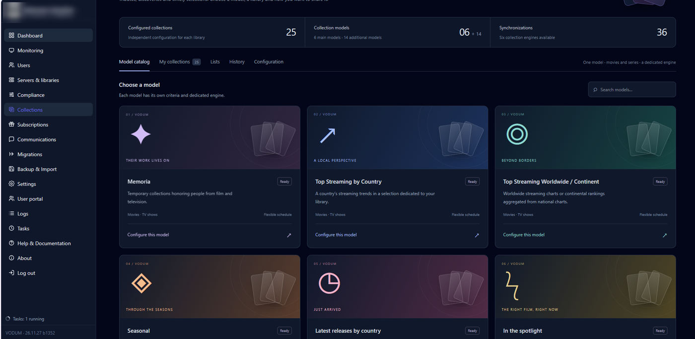

# Collections

Collections creates and maintains curated collections in selected Plex or
Jellyfin libraries. Each saved configuration has a model, target libraries,
filters, publication choices and a schedule. Models differ in their source,
matching rules and provider capabilities; see [Models & sources](../collection-sources.md).

## Before you start

1. Add and synchronize your [media server and libraries](../servers-libraries.md).
2. Open **Collections → Settings** and configure the shared TMDb API key.
3. Add any additional key required by the selected source, such as a
   MyAnimeList Client ID. AniList does not require its own API key.
4. For acquisition, configure a compatible Sonarr/Radarr server, its saved
   request defaults and the route on each destination library.

API keys are hidden when you come back to the settings; leaving a key field
empty keeps the saved key. Never paste a key into a collection name, description
or support request.

## Quick start: create a collection

1. Choose a model and give the configuration a recognizable name.
2. Select compatible movie/series libraries. A second library is available for
   models that support it; libraries remain separate publication targets.
3. Choose the source ranking, country, language, limits and filters offered by
   that model. A limit of zero means unlimited where the editor offers it.
4. Choose the publication/acquisition mode and schedule, then save.
5. Run **Preview** and inspect selected titles, missing titles and planned ARR work.
6. Run the configuration to publish or process acquisitions.

**Preview** changes nothing on your servers and sends nothing to Sonarr/Radarr.
A configuration in "ARR only" mode requests the missing media without creating
a collection. Home visibility, order and priority depend on what Plex or
Jellyfin supports.

## Collection from a media list

In **More ways to discover**, choose **Media list**. Search the VODUM and custom
lists, then select one. The picker shows eight results per page in a bounded
area; the selected list stays visible when searching or changing pages.
The collection takes its name from the selected list.

Choose a movie library, a series library, or a movie/series pair, then configure
the usual limit, order, schedule, visibility and optional Arr acquisition.
Only enabled entries of the selected list matching each library type are used.
List edits take effect at the next run; Preview lets you inspect them first.
Unlike Franchise, this model publishes one selected list per library without
requiring two locally present movies. Lists in use cannot be deleted.

The TMDb key is still needed to match the titles. A title VODUM cannot match may
be missing from a new collection; a partial run keeps the titles already in the
collection instead of removing them.

## Delete a custom list

Open the custom list in **Lists** and use the trash icon beside the content
heading. Confirm the VODUM dialog to delete the list and its local entries.
Cancel or Escape leaves it intact. Media files in Plex/Jellyfin are retained.
VODUM bundled lists cannot be deleted. If the list is still linked, unlink it
from Franchise configurations first; for a Media list collection, change its
source or remove that configuration before deleting the source list.

## Chronological order of a list

VODUM lists come with a reference story order for the main continuity of each
franchise (for example the Star Wars saga from *The Acolyte* to *The Rise of
Skywalker*, or the MCU timeline). Entries without a clear place in that story,
such as LEGO titles, Elseworlds, separate continuities and specials, follow by
release date. Lists without a reference order, and your own lists, follow the
release dates.

Open the list in **Lists**: the media table shows the entries in the current
order, and the line under the list name says which order applies (VODUM,
yours, or release date).

To change the order, use the **↑** and **↓** arrows of the **Order** column,
between **Origin** and **Enabled**. Each move is saved right away; there is no
Save button. With a filter, an entry moves past the visible entry above or
below it. Your saved order always wins over the VODUM order.

Once you have your own order, the **↺** button in the **Order** column header
goes back to the default (chronological) order, after a confirmation (on lists
without a VODUM order, it goes back to the release order). **Sort by release date**, under the
list name, ignores every chronological order for this list; **Use the
chronological order** turns it back on.

Every entry of the list is part of the order, including disabled ones. An
entry added later appears at the end, marked *Not placed yet*, until you move
an entry. The order applies at the next synchronization.

Plex shows the collection in this custom order. Jellyfin cannot sort a
collection manually: the order is kept in VODUM and Jellyfin keeps its own
sort. Media files, paths and names are never changed.

## Link lists to Franchise configurations

In **Lists**, open a list and expand **Manage Franchise links** inside
**Linked collections and libraries**. Search by collection or library name,
then check or uncheck a configuration. Eight results are shown per page.
Each choice applies to all the libraries of the configuration, including a
movie/series pair. A configuration cannot be changed while it is running.

The Franchise editor shows only its linked lists. Add links from the Lists tab:
new custom lists are not added automatically. A Franchise configuration whose
lists were never chosen uses the VODUM lists; removing its last link leaves it
with no list.

Changes apply at the next synchronization. Unlinking can retire the VODUM
collection created for that list in that configuration; media files are retained.
Other models with a fixed discovery source cannot use these lists. For the
single-source **Media list** model, change the source in its collection editor.

## List posters

Posters shown in **Lists** are kept in a cache on VODUM's data volume, so they
still show during a provider outage. You can delete this cache safely: it is
rebuilt as images are viewed.

??? info "Technical details"
    The cache is in `collection_posters` beside the database (normally
    `/appdata/collection_posters`); `VODUM_COLLECTION_POSTER_CACHE_DIR` changes the
    location. Images are reused for 30 days and the cache is trimmed toward 256 MiB.

    When the internal key of a Franchise collection changes, VODUM keeps the same
    collection on the server. A collection with the same title that VODUM did not
    create is a collision: it is never adopted, deleted or overwritten, and it can
    prevent the publication of that list.

## Jellyfin display order

Jellyfin decides the order in which a collection is displayed. When one of the
selected libraries is on Jellyfin, the **Media order** option is replaced by an
explanation. With only Plex libraries, the option is available. In a mixed
Plex/Jellyfin configuration, the Plex library keeps the saved order.

## Run, stop and resume

Saved configurations can be edited, duplicated, turned on or off and run by hand.
Schedules need the global scheduler and the **Run collections** task to be enabled.
A run can wait while a server is unavailable, the library inventory is refreshing
or another collection is running: the configuration card says why.

**Stop** asks the run to stop at the next safe point; a request already sent to a
server finishes first. Long runs continue from where they stopped. Check the
current run and the history before starting the same work again.

## Understand the result

Open the run history to see the result per library, the titles and what was
sent to Sonarr/Radarr. A green configuration can still have titles that are not
in your library or are waiting to be downloaded: that is normal.

- **Information only**: fewer titles than the limit, downloads pending, known
  Jellyfin display limits. The run is still a success.
- **To review**: a failure to publish, to read the source, to set the artwork or
  to request a download.

When VODUM cannot match a title with certainty, it leaves it in place rather than
removing it. A collection that VODUM did not create is never overwritten, even
with the same name.

## Remove a configuration

The deletion window asks whether to also remove the collections created on your
servers. Read it carefully: deleting can remove more than the card. Create a
backup before deleting a configuration used on your servers.
