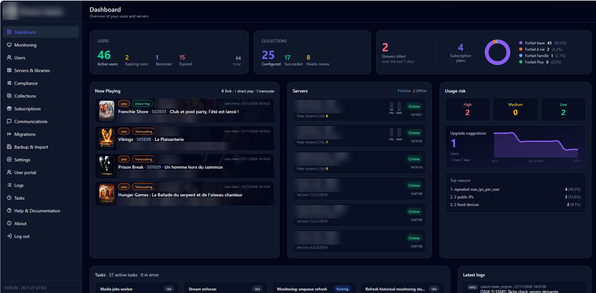

# Dashboard

The dashboard is the home page of administration. It summarizes your users by
status, your servers, collections, subscriptions, current playback, upcoming
tasks and the latest logs. Each card opens the matching section.

## Collections card

This card appears once you have at least one collection. Each collection is
counted once, whatever the number of libraries:

- **Successful**: the last run succeeded on every selected library.
- **To review**: at least one library has a warning, a failure or no result yet.

A successful collection can still have titles missing from your libraries or
waiting to be downloaded by Sonarr/Radarr. Open [Collections](collections/index.md)
for the details per library.

## Loading

Some cards (usage history, subscriptions, server peaks, tasks) appear a moment
after the page. A card that is still loading does not mean zero.

## On a phone

The bottom bar gives quick access to Dashboard, Users, Monitoring and Servers,
with a full menu for the other sections. Lists and tables become cards that are
easier to read and tap. Large tables keep a horizontal scroll.
