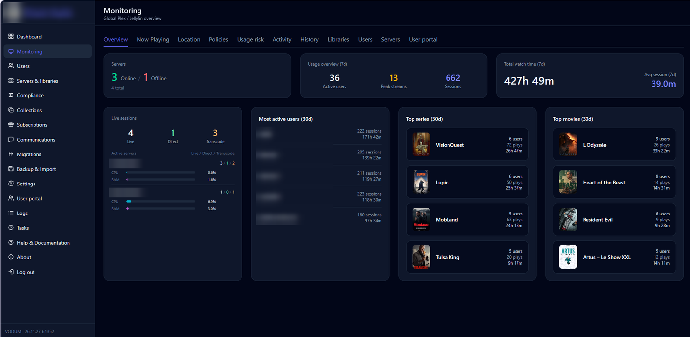

# Monitoring overview

**Monitoring** shows what is played on your servers, now and in the past. It
reads the data VODUM collects regularly, so its pages do not slow down Plex or
Jellyfin.

## Tabs

| Tab | What you find there |
| --- | --- |
| **Overview** | Users, servers, watch time and most-watched media |
| **Location** | The [location map](monitoring-map.md) of playback, live or over a period |
| **Now Playing** | Current streams with progress, quality and artwork |
| **Activity** | Playback trends over time |
| **History** | Finished sessions and their details |
| **Libraries** | Playback per library and [library growth](library-growth.md) |
| **Users** | Watch time and activity per user |
| **Servers** | Activity and availability per server |
| **Usage risk** | Repeated IP/device patterns and suggested plan upgrades |
| **Policies** | Your [stream policies](policies.md) and their recent enforcements |
| **User portal** | Portal usage, when the portal is enabled |

In **Now Playing**, the quality line shows the source (resolution, codec, HDR or
Dolby Vision) and, when the video is transcoded, what is sent to the player, for
example `4K HEVC HDR → 1080p H.264`.

## Freshness

- Pages show the server state and live counts first; rankings and history load
  just after. A section that is still loading does not mean zero.
- A notice appears on historical tabs only while figures are being prepared,
  after a failed refresh, or when they are out of date.
- Automatic refresh pauses when the page is hidden and resumes when you come back.
- If a server misses one Now Playing check, VODUM tries it again after 5 minutes.

If figures look out of date or slow, see [Performance](performance.md).

## Usage risk

The **Usage risk** tab suggests plan upgrades for users who often play from
several IPs or devices. A task refreshes these suggestions every 30 minutes and
checks them again before notifying the user. Opening the report sends nothing.

!!! note "Good to know"
    Locations and shared IPs alone do not prove that an account is misused.
