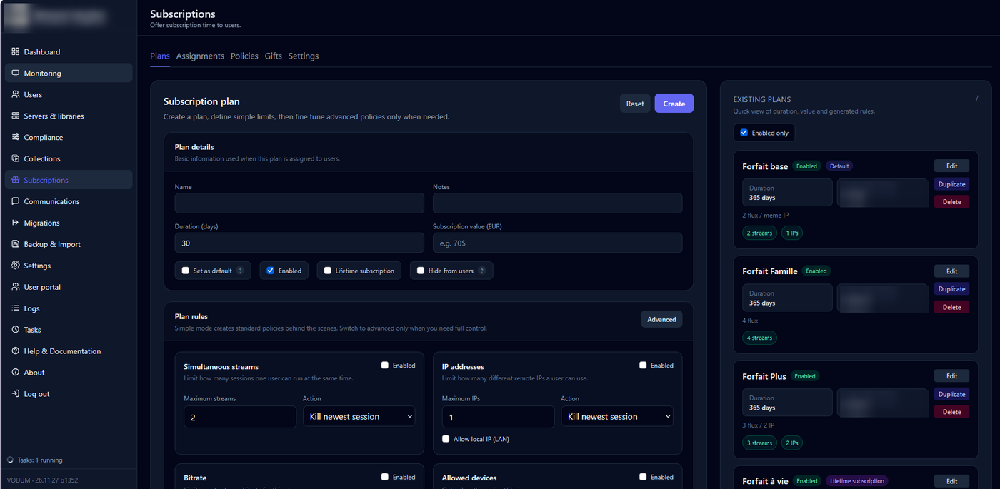

# Subscriptions & gifts

A plan (subscription template) sets a duration, a number of streams and other
defaults. Each user gets a plan, with an expiration date. The **Subscriptions**
page has five tabs: **Gifts**, **Plans**, **Assignments**, **Policies** and **Settings**.

## Quick start

1. In **Plans**, review the bundled plans or create your own (name, duration,
   streams, optional price).
2. In **Assignments**, give a plan to a user, or to all users of a server.
3. In **Settings**, choose what happens when a subscription expires (see below).
4. Optionally, add [stream policies](policies.md) in **Policies**.

## Plans

Plans can be enabled or disabled, duplicated and restored. Editing a plan later
does not change every user automatically: check the user's current values and
any personal override.

VODUM includes four example plans: **base sub**, **Family sub**, **Plus sub** and
**Lifetime sub**. They have no price filled in. **Lifetime sub** never expires,
starts disabled and hidden from the portal, and has no stream policy: review its
limits and enable it before using it.

**Restore default templates** adds back the example plans that are missing. It
never changes plans that already exist, and your edits and assignments are kept
on upgrade.

## Start and expiration

A subscription can start right away or at the user's first playback, so that an
invitation that is never used does not consume time.

| Mode | What happens at expiration |
| --- | --- |
| None | The status is tracked, nothing else happens |
| Warn only | The user is notified and a system stream policy applies; library shares are kept |
| Warn then disable | The user is warned during the grace period, then access is removed |
| Disable | Access is removed when the subscription expires |

Renewing a subscription removes the expiration policy and gives access back.
The Plex owner and Jellyfin administrators are never affected. After a bulk
assignment, check [Tasks](tasks.md) to see the access changes being applied.

## Gifts

A gift adds days to the subscription of one user, all users of a server, or all
eligible users. Check the target, the number of days and the history before
confirming. A gift changes subscription dates; it does not record a payment.

The gift history refreshes by itself every 30 seconds while the page is open.

## Renewal information in the portal

The portal shows each user their plan, dates and limits, and the renewal
information you allow. You can add an HTTPS renewal link to an external page.

In debug mode, experimental payment-link settings can describe PayPal.Me, Wero,
a bank transfer or your own instructions. Showing a payment link does not prove
that a payment was made and does not renew anything automatically: check the
payment before changing the expiration date.

For rewards and invited friends, see [Referrals & invitations](referrals.md).
