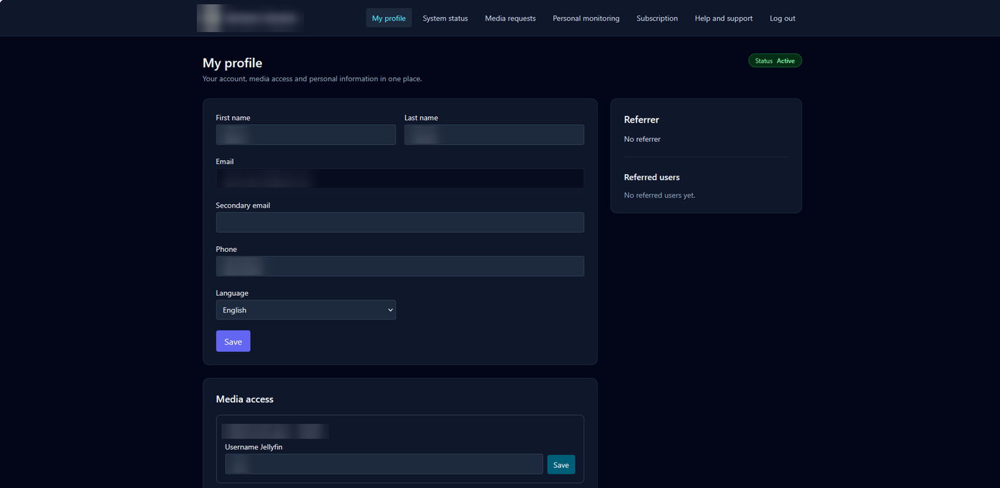
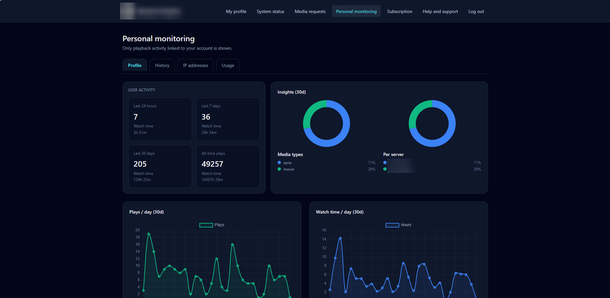

# Set up the portal

The user portal is an optional space at `/portal` where each of your users can
see their own account: subscription, media access, requests, server status and
support. It never gives access to VODUM administration.

## Quick start

1. Open **User portal** in administration and enable the portal. A local test
   mode lets you try it before opening it to everyone.
2. Enter the final public address (`https://…`) and choose the sign-in methods.
3. Configure email sending, needed for account activation and password recovery.
4. Choose the visible sections, the support contact and the renewal information.
5. Run the readiness checks, then test with a real user account.

The readiness checks look at VODUM's settings only; they do not set up your
domain, certificate or reverse proxy. Read [Security](security.md#public-user-portal-checklist)
before opening the portal to the internet.

A section you disable disappears from the portal menu and its pages are blocked.

## Sign-in methods

Local (email and password), Plex and Jellyfin sign-in can each be turned on or
off. Local users activate the account they were invited to and can reset their
password. A Jellyfin sign-in is tied to its server. A user can link several
sign-in methods to the same account; linking may ask them to sign in again.

A user cannot sign in when their method is disabled, their account is inactive
or suspended, or their session has expired.

## What users see

| Page | Content |
| --- | --- |
| Profile | Their details; they can change the fields you allow and their password |
| Subscription | Plan, dates, limits and renewal information; [invite a friend](referrals.md) when enabled |
| Requests | Search and request films and series ([Media requests](media-requests.md)) |
| System status | Their media accounts, libraries, and the status of their servers and request services |
| Monitoring | Their own playback, recent media and devices (IP addresses masked) |
| Support | Your contact details and, when enabled, a conversation with you |

The subscription status, library access and administrator roles stay under your
control. Payment links do not confirm a payment or renew anything automatically.

## System status

This page shows the user their linked media accounts, their libraries and the
status of their servers. Request services only appear when they are routed to
the user's libraries. Offline services are listed first, with **Offline since**
when the start of the outage is known. **Refresh** reloads the last saved status;
it does not test the servers again. Server addresses and other users' access are
never shown.

## Support

Set the support contact, whether its email is visible and whether users can send
quick messages. Their messages arrive in **Communications → Inbox**.

## Branding and phones

The portal uses your application name and logo. On phones it has quick links to
requests, subscription and profile, and a menu for the other pages; tables become
cards and renewal information opens in a panel.

See also [Portal permissions](user-portal-permissions.md) and the
[Portal API](portal-api.md).
