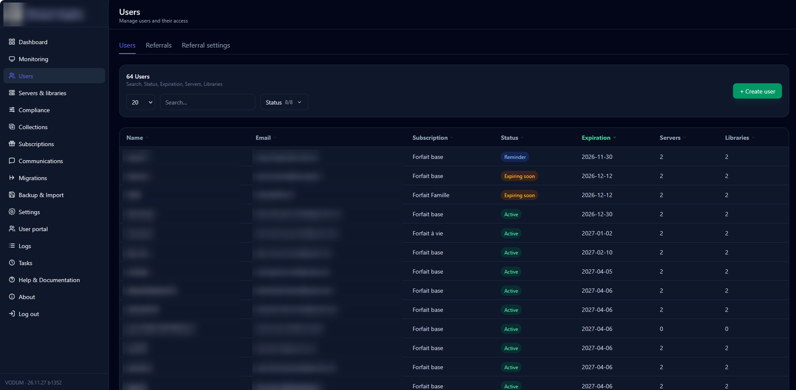

# Users

A VODUM user is one person. That person can have several media accounts, on
Plex or Jellyfin, across several servers. The subscription belongs to the
person; library access belongs to each media account.

## Quick start

1. Open **Users** and search by name, email or media username.
2. Click a user to open their page: contact details, subscription, media
   accounts and library access, notifications and history.
3. To add someone, click **Create user**, fill in the contact details, choose a
   plan and the servers and libraries to share.

## Find users

Filter by status, choose how many users per page and sort by name, email, status,
subscription, expiration or number of accesses. Your sort order and status filter
can be remembered; the search text is not. On a phone, each user is shown as a card.

## Create a user

**Create user** saves the person in VODUM, then sends the invitations to Plex or
Jellyfin and the welcome notification. These steps finish separately: check the
result on the user's page rather than assuming that every invitation was delivered.

## User page

Depending on the linked servers, the user page lets you:

- edit contact details, phone number, renewal and expiration;
- change the plan and, where allowed, the stream limit of this user;
- see the linked media accounts and change library access;
- set notification preferences and read the email/Discord history;
- change Plex sharing options, or the Jellyfin profile and password;
- see referral information and merge two users.

Access changes are sent to Plex or Jellyfin by a background task. Until it has
run, the change is *pending*. If nothing seems to happen, check [Tasks](tasks.md)
and [Logs](logs.md) before clicking again.

## Protected accounts

The Plex server owner and Jellyfin administrators are marked as protected: their
subscription cannot be edited and the owner cannot be deleted. A Jellyfin
administrator must lose that role in Jellyfin before it can be deleted.

## Merge two users

When the same person appears twice, use the merge preview on the user page:
choose which user to keep and check the media accounts and access that will move.
A matching name or email is not enough to be sure it is the same person. Some
merges are blocked (for example by a portal account or a media account conflict); the
preview explains why.

See also [Referrals & invitations](referrals.md) and the [user portal](user-portal.md).
